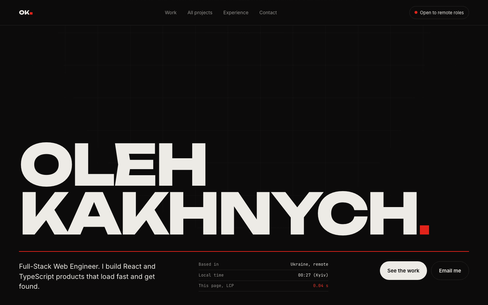
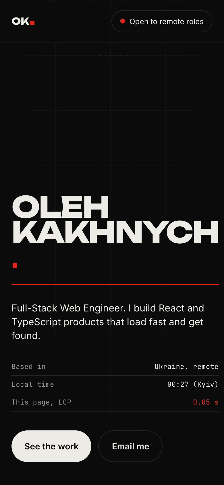
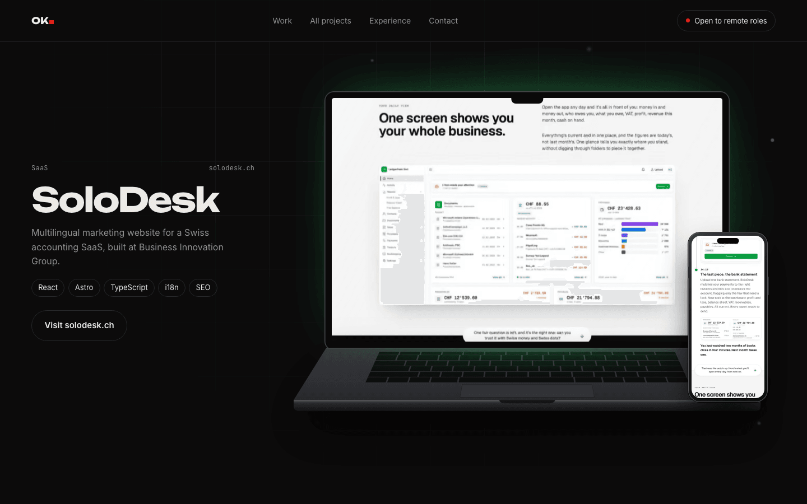

# Oleh Kakhnych — portfolio

Personal site of a Full-Stack Web Engineer (React, TypeScript). One page: hero with live Kyiv
time and this page's real LCP, a scroll-driven SoloDesk scene, every live project with filters
and a cursor preview, earlier work, experience and contact.

**Live:** _coming soon (Vercel)_


| Desktop                                  | Mobile                                 |
| ---------------------------------------- | -------------------------------------- |
|  |  |



## Stack

- Next.js 16 (App Router, Cache Components, Turbopack), React 19, TypeScript (strict)
- Tailwind CSS v4 tooling with hand-written CSS for the design (no Preflight)
- `next/font` (Unbounded, Inter, JetBrains Mono), `next/image` (AVIF/WebP)
- Metadata API, generated Open Graph image, `sitemap.xml`, `robots.txt`, JSON-LD `Person`
- Vitest + React Testing Library, Playwright + axe, Lighthouse CI, GitHub Actions

## How it is built

- Server Components by default. Client code only where the page reacts to time, scroll or
  input: `LocalTime`, `LiveLcp`, the scene shell, the project list and its cursor preview.
- Content is typed data in `src/content/*.ts`; logic that can be tested lives in `src/lib`.
- The featured scene writes its progress into CSS variables (`--open`, `--on`, `--scroll`) from
  one passive scroll listener and at most one `requestAnimationFrame` per frame. CSS does the
  rest with transforms and opacity. With reduced motion the scene shows its final state.
- The laptop keyboard is an SVG generated in perspective (`src/lib/laptop-base.ts`).

```
src/
  app/          layout, page, globals.css, opengraph-image, sitemap, robots
  components/   Header, sections/*, device/*, ui/*
  content/      profile, projects, experience, testimonials, types
  hooks/        useScrollProgress
  lib/          projects (filters, paging, grouping), laptop-base, json-ld
scripts/        convert-shots.mjs, check-contrast.mjs
e2e/            Playwright specs
```

## Run

```bash
npm ci
npm run dev        # http://localhost:3000
npm run build && npm start
```

Screenshots are served from `public/shots/*.webp`. To regenerate them from the source JPEGs:
`npm run shots -- path/to/jpegs`.

## Test

```bash
npm run lint
npm run typecheck
npm test           # unit and component tests (Vitest)
npm run contrast   # WCAG contrast of every text colour pair
npm run test:e2e   # Playwright at 1440 and 390 px, axe smoke test (builds and starts the app)
```

CI runs all of the above plus Lighthouse CI with a 95+ budget on every category.
